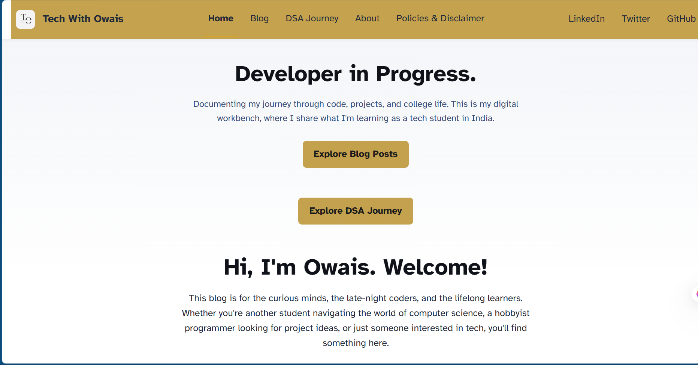

# TechWithOwais

**A cosmic mind exploring the universe of code, one idea at a time.**

TechWithOwais is my personal blogging website and learning journal — a space where I document what I learn, explore technical concepts, share experiments, and reflect on my journey through computer science.

**Live Website:** [techwithowais.co.in](https://techwithowais.co.in/)

---

## About the Project

I believe learning goes beyond consuming information. It involves questioning ideas, experimenting with them, understanding the underlying concepts, and putting that understanding into words.

TechWithOwais is a reflection of that belief.

This website serves as my evolving knowledge base, capturing the concepts I explore, the problems I solve, and the ideas that shape my growth as a developer.

## What You'll Find Here

- **Learning Paths** — Structured notes and explanations on topics I'm exploring.
- **Technical Blogs** — Insights, experiments, and lessons from my learning journey.
- **Computer Science** — Concepts, problem-solving approaches, and technical explorations.
- **Personal Reflections** — Thoughts on learning, building, and continuous improvement.

## The Philosophy

**Learn. Build. Understand. Document. Repeat.**

I'm a computer science student who believes that one of the best ways to strengthen understanding is to explain what you've learned.

Writing publicly encourages clarity, exposes gaps in my knowledge, and creates a record of progress over time.

This project isn't about pretending to know everything. It's about staying curious, learning consistently, and improving one concept at a time.

## Technology Stack

TechWithOwais is built using:

- **[Astro](https://astro.build/)** — A fast, content-focused web framework.
- **Markdown** — For writing and organizing articles.
- **CSS** — For styling and visual presentation.
- **[Vercel](https://vercel.com/)** — For deployment and hosting.
- **Git & GitHub** — For version control and project history.

## Suggestions & Contributions

I appreciate thoughtful feedback, bug reports, and ideas that could make TechWithOwais better.

If you spot an issue or have an idea for an improvement, feel free to open a GitHub Issue or contact me.

You're also welcome to propose changes through a Pull Request. Please discuss the proposed changes with me and obtain my approval before proceeding with any public redistribution or publication of modified versions.

Submitting a suggestion or Pull Request does not automatically grant permission to reuse, publish, or distribute the project's original code, design, or content.

## License & Copyright

**Copyright © 2026 Mohd. Owais. All rights reserved.**

TechWithOwais is a proprietary project and is not released under an open-source license.

You may view the public repository and suggest improvements, subject to GitHub's applicable terms. Permission is not granted to reproduce, redistribute, republish, or commercially exploit the original source code, website design, or original content without prior written permission from the copyright holder, except where permitted by applicable law.

Third-party libraries, dependencies, fonts, images, and other external materials remain subject to their respective licenses and terms.

For the full copyright notice, see the [LICENSE](LICENSE) file.

---

*Building today. Improving tomorrow.*

**Thanks for visiting TechWithOwais.**
